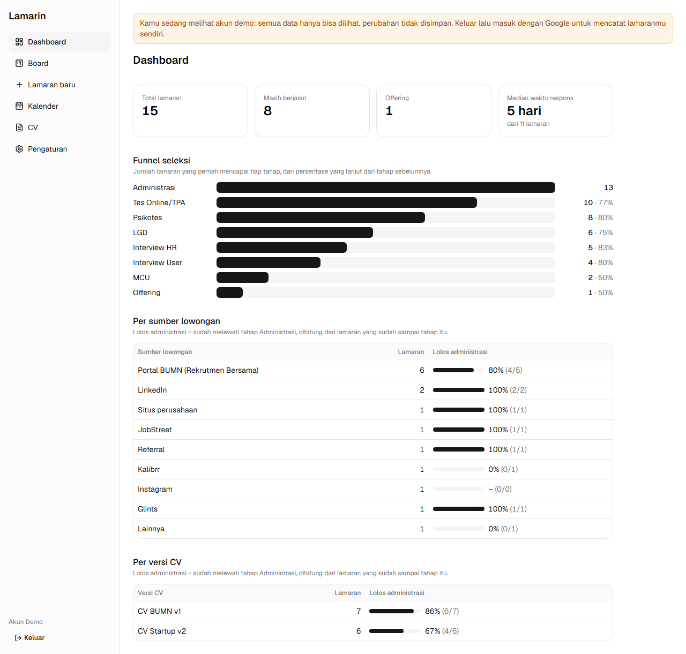
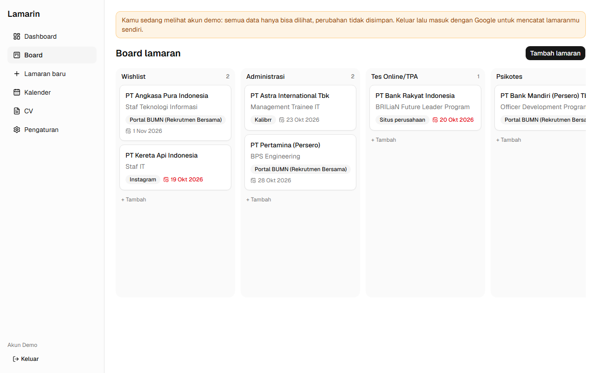
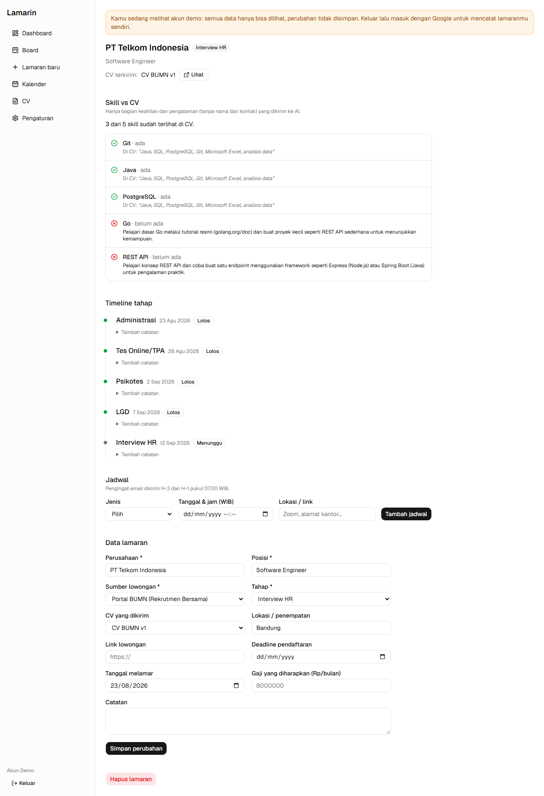
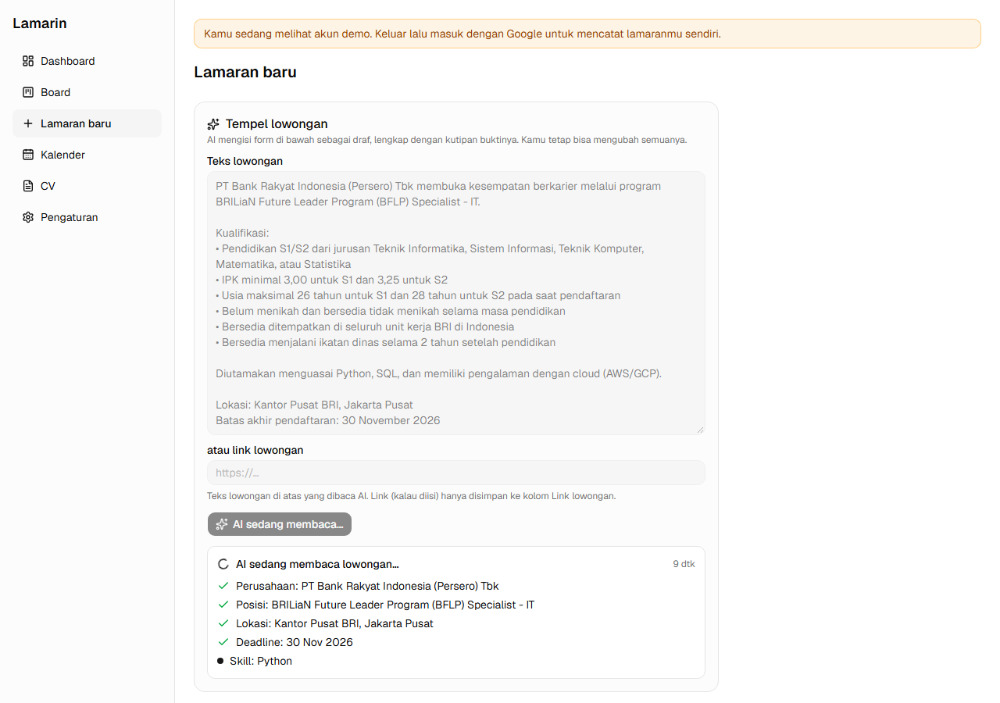
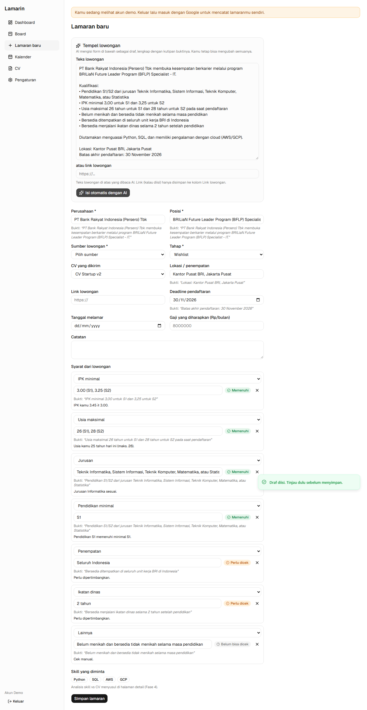
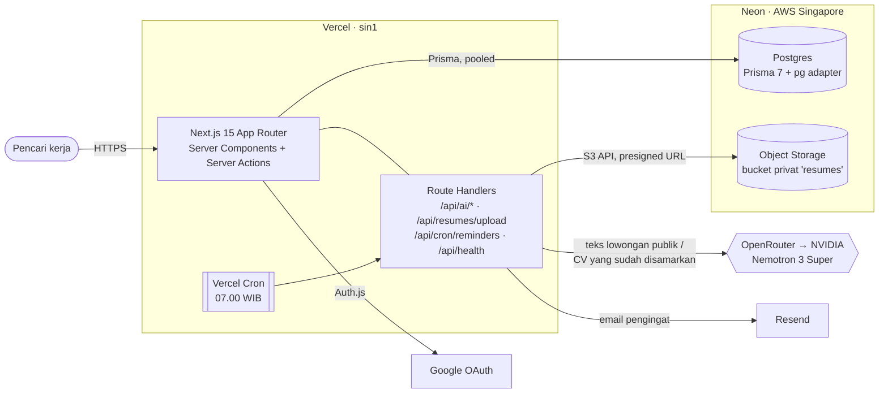
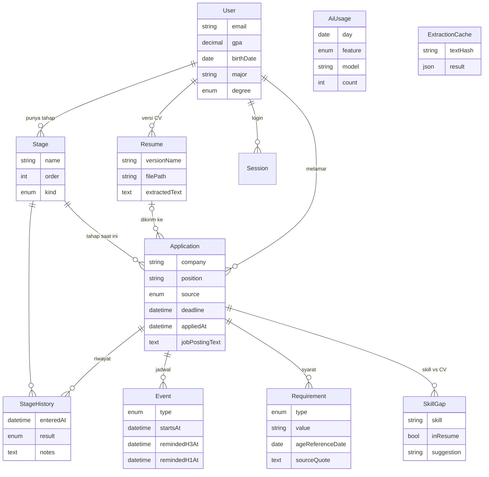

# Lamarin

Tracker lamaran kerja dengan bantuan AI, untuk pencari kerja di Indonesia yang melamar ke banyak tempat sekaligus: BUMN, bank, startup, atau perusahaan di bidang apa pun.

**Coba langsung:** https://tracker-lamaran-ashy.vercel.app → **Masuk sebagai demo** (akun contoh berisi 15 lamaran; hanya bisa dilihat).



## Fitur

- **Board kanban** dengan tahap seleksi khas Indonesia (Administrasi, Tes Online/TPA, Psikotes, LGD, Interview HR/User, MCU, Offering). Geser kartu antar kolom; riwayat tahap tercatat otomatis. Template BUMN/Bank, Startup, dan Umum.
- **Tempel lowongan → form terisi otomatis.** AI membaca teks atau link lowongan, lalu mengisi perusahaan, posisi, lokasi, deadline, skill, dan syarat administratif sebagai draf. Setiap isian disertai **kutipan bukti** dari lowongan, dan temuan AI muncul langsung saat AI membaca.
- **Cek kelayakan tanpa AI:** IPK minimal, batas usia (termasuk "per tanggal X" dan tanggal lahir 29 Februari), jurusan (dengan sinonim lintas bidang), jenjang pendidikan, penempatan, dan ikatan dinas, dibandingkan dengan profilmu. Hasilnya tampil sebagai badge di board.
- **Versi CV:** unggah PDF, tautkan ke lamaran, lihat lewat tautan sementara 60 detik.
- **Gap skill:** skill yang diminta lowongan vs CV-mu. Pencocokan teks dulu; AI hanya untuk sisanya, dan hanya menerima bagian keahlian/pengalaman yang sudah disamarkan (tanpa nama dan kontak).
- **Kalender dan pengingat email** H-3 dan H-1 untuk tes, interview, dan deadline.
- **Dashboard:** funnel seleksi, tingkat lolos administrasi per sumber lowongan dan per versi CV, median waktu respons perusahaan.

| Board | Detail lamaran |
|---|---|
|  |  |

| AI membaca lowongan | Draf dengan kutipan bukti dan cek kelayakan |
|---|---|
|  |  |

## Arsitektur



## Model data



Skema lengkap: [`prisma/schema.prisma`](prisma/schema.prisma). `AiUsage` (kuota harian) dan `ExtractionCache` (hasil ekstraksi per teks lowongan) tidak berelasi langsung.

## Setup lokal

Butuh Node 24, pnpm 12 (`corepack enable` atau `npm i -g pnpm`), dan akun Neon.

```bash
pnpm install                           # juga menjalankan `prisma generate`
npm i -g neon@latest && neon login
neon checkout dev --create             # branch Neon "dev" untuk lokal; tulis DATABASE_URL & AWS_* ke .env.local
pnpm db:migrate
pnpm db:seed                           # akun demo (demo@lamarin.local) + 15 lamaran + 2 CV; hanya me-reset akun demo
pnpm dev
```

Lengkapi `.env.local` sesuai [`.env.example`](.env.example): Google OAuth (`AUTH_*`), AI (`OPENROUTER_API_KEY`, `NVIDIA_API_KEY`, `LLM_MODEL`, `LLM_FALLBACK_MODEL`), Resend, `CRON_SECRET`, dan `DEMO_LOGIN_ENABLED=true` untuk tombol demo. Tanpa key AI, aplikasi tetap jalan dan tombol AI disembunyikan.

| Perintah | Fungsi |
|---|---|
| `pnpm dev` / `pnpm build` / `pnpm start` | jalankan / build / jalankan build (lokal butuh `AUTH_TRUST_HOST=true`) |
| `pnpm lint` · `pnpm typecheck` · `pnpm test` | ESLint · `tsc --noEmit` · Vitest (unit) |
| `pnpm test:e2e` | Playwright: login demo → buat lamaran → geser tahap → cek dashboard |
| `pnpm db:migrate` · `pnpm db:seed` | Prisma migrate dev · seed akun demo |
| `pnpm check:llm-provider` | gagal kalau ada jejak SDK/API vendor LLM yang dilarang (aturan 10 `CLAUDE.md`) |
| `pnpm ai:fixtures` | uji model AI dengan 3 contoh lowongan (hanya teks publik) |
| `pnpm storage:smoke` | upload PDF → presigned URL → bandingkan → hapus |

## Test dan CI

- **Unit (Vitest):** cek kelayakan, redaksi CV, alias skill, ekstraksi dan verifikasi kutipan, urutan retry/fallback provider AI, pengaman SSRF, pengingat, dan dashboard (angka dicocokkan dengan hitungan manual atas data demo).
- **E2E (Playwright):** alur utama di build produksi dengan akun demo yang bisa ditulisi.
- **GitHub Actions** ([`ci.yml`](.github/workflows/ci.yml)): lint, typecheck, unit test, `check:llm-provider`, lalu E2E pada branch Neon `ci` (dibuat *schema-only*, jadi tidak ada data asli; diisi `pnpm db:seed` di setiap run). Kredensial branch `ci` disimpan sebagai GitHub Secrets; `AUTH_SECRET` dibuat acak per run dan disamarkan di log.

## Deploy (Vercel)

- Project terhubung ke repo GitHub: push ke `master` → deploy produksi. Region fungsi `sin1`, sama dengan database.
- Build command (`vercel.json`): `prisma generate && prisma migrate deploy && next build`, jadi migrasi baru otomatis diterapkan.
- Env produksi memakai branch Neon `production`. `DEMO_READ_ONLY=true` membuat akun demo hanya bisa dilihat: semua server action dan route penulisan menolak, dan fitur AI dimatikan untuk demo.
- Redirect URI Google: `https://<domain>/api/auth/callback/google`.

## Keamanan dan privasi

Diaudit di Fase 5:

- Setiap query data pengguna difilter `userId` dari session (`requireUser()`), langsung atau lewat relasi; setiap mutasi berdasarkan `id` didahului cek kepemilikan.
- Kredensial database, storage, dan AI hanya di server (`import "server-only"`); tidak ada `NEXT_PUBLIC_` untuk secret; bundle client dipindai tanpa temuan.
- Bucket CV privat: akses tanpa tanda tangan → 403; file hanya lewat presigned URL 60 detik setelah cek kepemilikan.
- Teks CV ke LLM hanya lewat `redact()`. Log hanya berisi fitur, model, durasi, dan status (tanpa isi prompt atau CV).
- Endpoint gratis NVIDIA dan model gratis OpenRouter bisa memakai data yang dikirim untuk training, karena itu teks lowongan (publik) boleh dikirim, CV harus disamarkan.

## Keputusan desain

### Koneksi database (Neon + Prisma 7)

- **Runtime:** Prisma Client dengan driver adapter `@prisma/adapter-pg` (node-postgres) ke `DATABASE_URL`, yaitu connection string **pooled** (`-pooler`, PgBouncer). Skill agent Neon merekomendasikan node-postgres untuk Vercel (Fluid compute, pool dipakai ulang antar request), ditambah `attachDatabasePool` dari `@vercel/functions` supaya koneksi idle ditutup rapi. Driver HTTP `@neondatabase/serverless` hanya disarankan untuk runtime edge, dan kita tidak memakai edge.
- **Migrasi:** `prisma.config.ts` memakai `DATABASE_URL_UNPOOLED` (koneksi langsung). Prisma Migrate lewat PgBouncer mode transaksi bisa gagal (`prepared statement "s0" already exists`). Prisma 7 tidak lagi memakai `directUrl` di `schema.prisma`; URL CLI ada di `prisma.config.ts` (opsional, supaya `prisma generate` jalan tanpa database), URL runtime ada di `src/lib/db.ts`.
- **Branch Neon:** `production` (Vercel), `dev` (lokal), `ci` (GitHub Actions, schema-only). Database gratis Neon tidur setelah 5 menit tidak dipakai, jadi request pertama setelahnya bisa lambat.

### File CV (Neon Object Storage)

- `src/lib/storage.ts`: `S3Client` dengan `forcePathStyle: true`. Endpoint, region, dan kredensial dibaca otomatis oleh AWS SDK dari variabel standar `AWS_*` yang ditulis Neon CLI.
- Upload lewat `POST /api/resumes/upload`: validasi MIME + magic bytes `%PDF` + maks. 4 MB, teks diekstrak dengan pdf-parse (`serverExternalPackages` di `next.config.ts`), lalu disimpan di `cv/{userId}/{resumeId}.pdf`.

### Auth dan demo

- Auth.js v5, Google provider, Prisma adapter, session **database** (bukan JWT), jadi session bisa dicabut dengan menghapus baris `Session`.
- Tidak ada middleware: guard login ada di `src/app/(app)/layout.tsx`, dan setiap server action/halaman memanggil `requireUser()`.
- "Masuk sebagai demo" (`src/actions/demo.ts`) membuat session database untuk akun demo dan memasang cookie session yang sama dengan Auth.js. Aktif hanya dengan `DEMO_LOGIN_ENABLED=true`; `DEMO_READ_ONLY=true` di produksi.

### Seed dan data demo

`prisma/seed.mts` dijalankan langsung oleh Node (tanpa `tsx`); Prisma Client digenerate dengan `importFileExtension = "ts"`. Data demo ada di `src/lib/demo-data.ts`, dipakai bersama oleh seed dan unit test dashboard.

### Kalender dan pengingat

- Kalender: grid bulanan buatan sendiri (tanpa library kalender), menampilkan event + deadline lamaran.
- Pengingat: Vercel Cron `0 0 * * *` (07.00 WIB) → `/api/cron/reminders` dengan `Authorization: Bearer $CRON_SECRET`. Reminder H-3 juga dikirim pada H-2 kalau H-3 terlewat. Kolom `remindedH3At`/`remindedH1At` di-*claim* (update bersyarat) **sebelum** email dikirim, jadi run ganda/bersamaan tidak mengirim dua kali; kalau Resend gagal, claim dilepas supaya bisa dicoba lagi. Event yang dijadwal ulang mendapat pengingat baru.
- Tanpa domain sendiri, `EMAIL_FROM=onboarding@resend.dev` hanya bisa mengirim ke email pemilik akun Resend.

### AI: provider dan model

```
LLM_MODEL=openrouter:nvidia/nemotron-3-super-120b-a12b:free     # utama
LLM_FALLBACK_MODEL=nvidia:nvidia/nemotron-3-super-120b-a12b     # cadangan
```

Urutan di `src/lib/ai/provider.ts`: model utama dengan reasoning **mati** → kalau output gagal validasi Zod, ulang sekali dengan reasoning **menyala** + pesan error → kalau gagal/429/5xx/timeout (60 detik), model cadangan dengan urutan yang sama → `AiUnavailableError` ("AI sedang tidak tersedia, silakan isi manual"). ID model dengan nama vendor yang dilarang ditolak saat start.

Uji 3 fixture (`src/lib/ai/job-fixtures.ts`, skor 8 poin: perusahaan, posisi, deadline, jenis syarat, IPK, usia, tanggal acuan usia, skill):

| Kandidat | BUMN | Bank | Startup |
|---|---|---|---|
| DeepSeek V4.1 Flash, GLM 5.3 Flash (NVIDIA) | timeout >90 dtk | – | – |
| Nemotron Super, NVIDIA, reasoning on | 8/8 · 43–56 dtk | timeout | 8/8 · 28–53 dtk |
| Nemotron Super, NVIDIA, reasoning off | 8/8 · 15 dtk | 8/8 · 20 dtk | JSON tidak valid |
| **Nemotron Super, OpenRouter, reasoning off** | **8/8 · 10 dtk** | **8/8 · 13 dtk** | **8/8 · 6 dtk** |
| Nemotron Super, OpenRouter, reasoning on | 8/8 · 37 dtk | 8/8 · 51 dtk | 8/8 · 48 dtk |
| Nemotron Nano (NVIDIA), Gemma 4 / Nemotron 3.5 VL (OpenRouter) | sering timeout / 429 / 502 | | |

Reasoning tidak menaikkan skor di tugas ekstraksi ini, tapi 4–5× lebih lambat dan sering timeout, jadi hanya dipakai saat percobaan ulang. Router acak `openrouter/free` tidak dipakai: modelnya berganti tiap request dan tidak bisa dikendalikan.

### AI: ekstraksi lowongan

- **Progres langsung:** jawaban AI di-stream sebagai teks biasa berisi JSON (skema JSON ditulis di prompt), lalu `parsePartialJson` mengubahnya jadi temuan sementara yang tampil di form. `response_format` sengaja tidak dikirim: diukur, dengan `json_object` maupun `json_schema` OpenRouter menahan seluruh jawaban jadi satu potongan, sedangkan tanpa itu token dikirim satu per satu (temuan pertama ±2 detik). Hasil akhir dibersihkan dari fence/teks tambahan (`src/lib/ai/json-text.ts`), lalu divalidasi Zod. Route `/api/ai/extract` membalas NDJSON: `status`, `partial`, lalu `result` atau `error`.
- **Alur:** normalisasi teks → cache (`sha256(prompt + teks)`, jadi mengubah prompt otomatis membatalkan cache lama) → kuota harian (`AiUsage`) → LLM → buang item yang kutipannya tidak ada di teks → simpan cache. Hasil kosong (halaman yang butuh JavaScript/login) tidak di-cache dan ditampilkan sebagai pesan yang jelas.
- **Link lowongan:** diambil di server dengan pengaman SSRF (alamat privat/loopback ditolak, redirect divalidasi ulang). Data `JobPosting` JSON-LD (untuk Google Jobs) dibaca lebih dulu; di halaman panjang, dipilih potongan dengan **jenis** kata kunci lowongan terbanyak (di magentaku.id, isi lowongan ada di karakter ke-122 ribu setelah filter yang mengulang satu kata 105 kali).
- **Syarat per jenjang** ("IPK 3,00 untuk S1 dan 3,25 untuk S2") diekstrak sebagai satu item `3.00 (S1), 3.25 (S2)`, lalu `checkRequirement` memakai angka untuk jenjang di profil.

### Cek kelayakan

`src/lib/eligibility/check.ts` murni deterministik, tanpa AI, dan dihitung saat halaman dibuka (bukan disimpan), supaya selalu mengikuti profil terbaru. Status keseluruhan = status terburuk (Tidak memenuhi > Perlu dicek > Belum bisa dicek > Memenuhi). Jurusan yang tidak cocok → "Perlu dicek", bukan "Tidak memenuhi", karena lowongan sering menulis "jurusan terkait".

### Gap skill dan redaksi CV

`POST /api/ai/skill-gap { applicationId }`:

1. Skill lowongan diambil dari `ExtractionCache` (teks lowongan tersimpan di `Application.jobPostingText`).
2. **Tanpa AI:** skill dicocokkan dengan teks CV memakai alias (`src/lib/ai/skill-aliases.ts`, termasuk tools non-IT: Excel, SAP, Accurate, AutoCAD, Canva, bahasa Inggris/TOEFL, Brevet, K3, dll.). Yang ketemu langsung ✅.
3. Sisanya + CV yang sudah melewati `redact()` (`src/lib/ai/redact.ts`: hanya bagian keahlian/pengalaman/proyek/organisasi; email, nomor HP, URL, NIK/angka panjang, baris alamat, dan setiap kata nama pemilik dihapus; maks. 6.000 karakter) dikirim ke LLM. Klaim "ada di CV" tanpa kutipan yang benar-benar ada di teks redaksi diturunkan jadi ❌. Kalau CV tidak punya judul bagian yang dikenali, seluruh teks yang sudah dibersihkan dipakai supaya analisis tetap jalan.
4. Tanpa AI (key kosong, kuota habis, server down), hasil pencocokan teks tetap disimpan.

### Dashboard

Semua angka dihitung di server oleh fungsi murni `computeDashboard` (`src/lib/dashboard.ts`), lalu dirender sebagai HTML/CSS biasa (bar satu warna + label langsung + tabel), tanpa library chart dan tanpa JS di client. Recharts belum dipakai; tambahkan kalau perlu grafik tren waktu.

- **Funnel:** lamaran yang pernah mencapai tiap tahap seleksi (tahap terjauh yang IN_PROGRESS/OFFER di `StageHistory`; Ditolak tidak dihitung sebagai kemajuan) + persentase lanjut dari tahap sebelumnya.
- **Lolos administrasi** (per sumber, per versi CV): sudah melewati tahap seleksi pertama, dihitung dari lamaran yang sudah sampai tahap itu.
- **Waktu respons:** median hari dari `appliedAt` ke perpindahan tahap pertama.

`src/lib/dashboard.test.ts` memakai data demo yang sama dengan `pnpm db:seed` dan mencocokkan setiap angka dengan hitungan manual (funnel 13 → 10 → 8 → 6 → 5 → 4 → 2 → 1, median 5 hari, dst.).

---

Spesifikasi dan aturan kerja proyek: [`CLAUDE.md`](CLAUDE.md).
