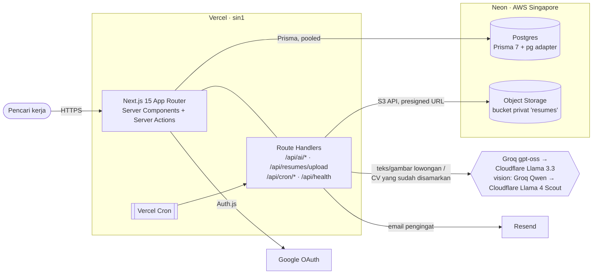
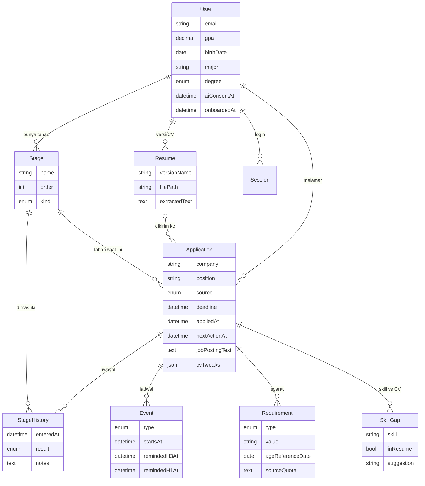

# Lajur

Tracker lamaran kerja untuk pencari kerja di Indonesia yang melamar ke banyak tempat sekaligus: BUMN, bank, startup, atau perusahaan di bidang apa pun.

Coba di https://lajur.vercel.app, lalu pilih **Masuk sebagai demo**. Akun demo berisi 15 lamaran contoh dan hanya bisa dilihat.


## Fitur

- Board kanban dengan tahap seleksi yang umum di sini: Administrasi, Tes Online/TPA, Psikotes, LGD, Interview HR/User, MCU, Offering. Riwayat tahap tercatat setiap kali kartu digeser. Ada template BUMN/Bank, Umum, Retail/Pabrik, CPNS/Instansi Pemerintah, dan Startup, serta tampilan daftar dengan pencarian dan filter.
- Mulai pakai: pengguna baru dipandu langkah demi langkah (profil, jenis lowongan, CV, lamaran pertama) sebelum masuk ke aplikasi.
- Tambah dengan AI: tempel teks, link, atau gambar poster lowongan (screenshot Instagram, Ctrl+V), dan form terisi sebagai draf (perusahaan, posisi, lokasi, deadline, skill, syarat). Setiap isian disertai kutipan dari lowongan sebagai bukti.
- Update dari email: tempel email dari rekruter (hasil seleksi, undangan tes), dan AI mengusulkan perpindahan tahap dan jadwal untuk lamaran yang cocok. Nama, kontak, dan info login disamarkan sebelum dikirim, dan semua usulan ditinjau dulu.
- Cek kelayakan tanpa AI: IPK minimal, batas usia (termasuk "per tanggal X" dan lahir 29 Februari), jurusan dengan sinonim, jenjang, penempatan, dan ikatan dinas dibandingkan dengan profilmu.
- Versi CV: unggah PDF, tautkan ke lamaran, buka lewat tautan sementara 60 detik.
- Cek CV: skill lowongan yang sudah dan belum terlihat di CV, plus saran perbaikan yang tidak mengarang pengalaman. Bisa dipakai sebelum menyimpan lamaran.
- Kalender (jadwal berentang tampil sebagai satu bar, warna per jenis: deadline, tes, interview, lainnya), pengingat email H-3 dan H-1 untuk tes dan interview, dan pengingat follow-up.
- Dashboard untuk hari ini (jadwal 7 hari, lamaran yang perlu di-follow-up, pipeline) dan halaman Analytics (funnel, tahap yang paling sering gagal, respons per sumber lowongan dan per versi CV).
- Ekspor semua data ke CSV, dan hapus akun beserta isinya.
- Bisa dipasang di layar utama HP atau laptop (PWA, lewat Pengaturan → Pasang aplikasi), dengan halaman "tidak ada koneksi" saat offline. Tema mengikuti perangkat, atau dipilih terang/gelap.

| Board | Detail lamaran |
|---|---|
|  |  |

| AI membaca lowongan | Draf dengan kutipan bukti dan cek kelayakan |
|---|---|
|  |  |

## Arsitektur



## Model data



Skema lengkap ada di [`prisma/schema.prisma`](prisma/schema.prisma). `AiUsage` (kuota AI harian) dan `ExtractionCache` (hasil ekstraksi per teks lowongan) berdiri sendiri.

## Setup lokal

Butuh Node 24, pnpm 12 (`corepack enable`), dan akun Neon.

```bash
pnpm install                    # juga menjalankan prisma generate
npm i -g neon@latest && neon login
neon checkout dev --create      # branch Neon "dev"; menulis DATABASE_URL dan AWS_* ke .env.local
pnpm db:migrate
pnpm db:seed                    # akun demo + 15 lamaran + 2 CV (hanya akun demo yang di-reset)
pnpm dev
```

Variabel lainnya ada di [`.env.example`](.env.example): Google OAuth, provider AI, Resend, `CRON_SECRET`, dan `DEMO_LOGIN_ENABLED=true` untuk tombol demo. Tanpa key AI aplikasi tetap jalan; tombol AI disembunyikan dan form diisi manual. Email akun demo masih `demo@lamarin.local` dari nama lama aplikasi; mengubahnya akan membuat reset harian membuat akun demo baru.

| Perintah | Fungsi |
|---|---|
| `pnpm dev` · `pnpm build` · `pnpm start` | jalankan, build, jalankan hasil build (lokal butuh `AUTH_TRUST_HOST=true`) |
| `pnpm lint` · `pnpm typecheck` · `pnpm test` | ESLint, `tsc --noEmit`, Vitest |
| `pnpm test:e2e` | Playwright: login demo, buat lamaran, geser tahap, cek dashboard |
| `pnpm db:migrate` · `pnpm db:seed` | Prisma migrate dev, seed akun demo |
| `pnpm check:llm-provider` | gagal kalau repo memakai SDK vendor LLM yang tidak diizinkan |
| `pnpm ai:smoke` · `pnpm ai:fixtures` | uji provider AI sungguhan dengan lowongan contoh (hanya teks publik) |
| `pnpm storage:smoke` | upload PDF, buka presigned URL, bandingkan isinya, hapus |

## Test dan CI

- Unit test (Vitest) untuk cek kelayakan, redaksi CV, alias skill, verifikasi kutipan, Cek CV, urutan retry dan fallback provider AI, pengaman SSRF, pengingat, dan angka dashboard (dicocokkan dengan hitungan manual atas data demo).
- E2E (Playwright) menjalankan alur utama di build produksi dengan akun demo yang bisa ditulisi.
- GitHub Actions ([`ci.yml`](.github/workflows/ci.yml)) menjalankan lint, typecheck, unit test, `check:llm-provider`, lalu E2E di branch Neon `ci`. Branch itu dibuat schema-only, jadi tidak berisi data asli, dan diisi `pnpm db:seed` setiap run.

## Deploy

- Push ke `master` men-deploy produksi di Vercel. Region fungsi `sin1`, sama dengan database.
- Build command di `vercel.json` adalah `prisma generate && prisma migrate deploy && next build`, jadi migrasi baru ikut diterapkan.
- `DEMO_READ_ONLY=true` di produksi membuat akun demo hanya bisa dilihat. Akun demo di-reset setiap hari pukul 06.00 WIB (`/api/cron/demo-reset`) dengan logika yang sama dengan `pnpm db:seed`.
- Perintah database dari laptop selalu mengenai database di `.env.local`, karena `DATABASE_URL` produksi disimpan sebagai variabel sensitif. Untuk mengubah data produksi, pakai cron atau build Vercel.
- Redirect URI Google: `https://<domain>/api/auth/callback/google`.

## Keamanan dan privasi

- Setiap query data pengguna difilter dengan `userId` dari session (`requireUser()`), dan setiap mutasi berdasarkan `id` didahului cek kepemilikan.
- Kredensial database, storage, dan AI hanya ada di server (`import "server-only"`), tanpa `NEXT_PUBLIC_`.
- Bucket CV privat. File hanya bisa dibuka lewat presigned URL 60 detik setelah cek kepemilikan.
- Sebelum dikirim ke AI, CV dipotong ke bagian keahlian dan pengalaman, lalu email, nomor HP, URL, NIK, nama, dan domisili diganti placeholder (`[NAME_1]`, …) yang dikembalikan di jawabannya. Log hanya berisi fitur, model, durasi, token, dan status.
- Sesuai UU PDP, fitur AI baru aktif setelah pengguna setuju di Pengaturan bahwa teksnya diproses AI pihak ketiga di luar negeri. Persetujuan bisa ditarik kapan saja.
- Produksi hanya memakai Groq dan Cloudflare Workers AI. NVIDIA API Catalog dan OpenRouter khusus pengembangan, karena tier gratisnya boleh memakai input untuk training, dan aplikasi menolaknya saat `NODE_ENV=production`.

## Catatan desain

### Database dan storage

- Prisma Client memakai driver adapter `@prisma/adapter-pg` ke `DATABASE_URL` yang pooled. node-postgres cocok untuk Fluid compute di Vercel karena pool dipakai ulang antar request; `attachDatabasePool` dari `@vercel/functions` menutup koneksi yang menganggur.
- Migrasi memakai `DATABASE_URL_UNPOOLED` (lewat `prisma.config.ts`), karena Prisma Migrate lewat PgBouncer mode transaksi bisa gagal.
- Branch Neon: `production` (Vercel), `dev` (lokal), `ci` (GitHub Actions). Database gratis Neon tidur setelah 5 menit, jadi request pertama setelahnya agak lambat.
- `src/lib/storage.ts` memakai `S3Client` dengan `forcePathStyle: true`. Upload lewat `POST /api/resumes/upload` divalidasi (MIME, magic bytes `%PDF`, maks. 4 MB), teksnya diekstrak dengan pdf-parse, lalu disimpan di `cv/{userId}/{resumeId}.pdf`.

### Auth dan demo

- Auth.js v5 dengan Google dan session database, jadi session bisa dicabut dengan menghapus barisnya.
- Guard login ada di `src/app/(app)/layout.tsx`, dan setiap server action serta halaman memanggil `requireUser()`.
- Layout yang sama mengarahkan pengguna dengan `onboardedAt` kosong ke wizard `/mulai` (`src/app/mulai/page.tsx`). Profil dan jenis lowongan wajib; CV dan lamaran pertama boleh dilewati. Langkahnya memakai ulang form yang sama dengan Pengaturan, CV, dan Lamaran baru. Pengguna yang mendaftar sebelum wizard ada dan akun demo tidak melewatinya.
- "Masuk sebagai demo" (`src/actions/demo.ts`) membuat session database untuk akun demo, hanya kalau `DEMO_LOGIN_ENABLED=true`.

### Pengingat

Vercel Cron memanggil `/api/cron/reminders` setiap hari pukul 07.00 WIB dengan `Authorization: Bearer $CRON_SECRET`. Kolom `remindedH3At`/`remindedH1At` diklaim dengan update bersyarat sebelum email dikirim, jadi cron yang berjalan dua kali tidak mengirim email dua kali; kalau Resend gagal, klaimnya dilepas. Tanpa domain sendiri, `EMAIL_FROM=onboarding@resend.dev` hanya bisa mengirim ke pemilik akun Resend.

### AI

- Semua panggilan lewat `src/lib/ai/provider.ts`, dengan daftar provider di `llm-config.ts`. Urutannya Groq gpt-oss-20b, lalu gpt-oss-120b, lalu Cloudflare Llama 3.3 70B. Output memakai `response_format: json_schema` dan divalidasi Zod. Output yang tidak valid diulang sekali dengan pesan error-nya; 429, 5xx, dan timeout pindah ke model berikutnya.
- Jawaban AI tidak di-stream, karena structured output Groq dan Cloudflare tidak mendukungnya. `/api/ai/extract` hanya mengirim status tahapannya ke browser (NDJSON).
- Teks lowongan dipotong 12.000 karakter dan CV teredaksi 6.000 karakter, supaya muat di batas gratis Groq 8K token per menit.
- Hasil ekstraksi di-cache per `sha256` teks lowongan, jadi lowongan yang sama tidak memakai kuota lagi. Item yang kutipannya tidak ada di lowongan dibuang. Skill yang kutipannya disusun ulang oleh model tetap dipakai kalau nama skill-nya memang tertulis.
- Gambar poster diperkecil di browser (JPEG ≤ 4 MP, di bawah batas body Vercel 4,5 MB), dicek tipe dan magic bytes-nya di server, lalu disalin teksnya oleh model vision (`GROQ_VISION_MODEL`, lalu `CLOUDFLARE_VISION_MODEL`). Teks itu masuk ke alur ekstraksi yang sama dengan teks tempelan, jadi kutipan diverifikasi terhadap transkripsinya. Satu gambar memakai satu kuota: langkah menyalin dicatat sebagai `READ_POSTER` tapi tidak dihitung, karena model vision punya jatah provider sendiri. Panel "Tambah dengan AI" menampilkan sisa kuota hari ini.
- Link lowongan diambil di server dengan pengaman SSRF. Data `JobPosting` JSON-LD dibaca lebih dulu; di halaman panjang, dipilih bagian dengan kata kunci lowongan paling beragam.
- Cek CV (`src/lib/ai/cv-check.ts`) mencocokkan skill dengan alias lebih dulu, lalu satu panggilan AI mengecek sisanya dan memberi maks. 8 saran. Saran "tulis ulang" hanya memoles teks yang ada di CV; saran "lengkapi" berupa instruksi. Server membuang saran yang menulis ulang teks yang tidak ada di CV, memuat angka baru, mengklaim skill yang tidak dimiliki, atau menyodorkan contoh kalimat CV.

### Tanggal dan tampilan

- Semua jam ditampilkan dan diisi dalam WIB (`src/lib/dates.ts`), apa pun zona waktu perangkatnya, karena pengingat email juga dihitung dalam WIB. Kolom tanpa jam (`@db.Date`, misalnya `birthDate`) disimpan sebagai tengah malam UTC; tengah malam WIB akan terpotong menjadi hari sebelumnya.
- Dropdown (`Select`) dan pemilih tanggal (`DatePicker`, react-day-picker) digambar oleh halaman, bukan oleh browser: daftar pilihan dan kalender bawaan browser tidak bisa memakai font, warna, dan bahasa aplikasi. Nilainya sama dengan input bawaan (`YYYY-MM-DD` / `YYYY-MM-DDTHH:mm`), jadi parsing di server tidak berubah.
- `scrollbar-gutter: stable` menyisakan ruang scrollbar di semua halaman, supaya pindah dari board (pendek) ke daftar (panjang) tidak menggeser tampilan.

### Cek kelayakan

`src/lib/eligibility/check.ts` deterministik, tanpa AI, dan dihitung setiap halaman dibuka supaya selalu mengikuti profil terbaru. Status keseluruhan diambil dari status terburuk. Jurusan yang tidak cocok ditandai "Perlu dicek", bukan "Tidak memenuhi", karena lowongan sering menulis "jurusan terkait". Syarat per jenjang ("IPK 3,00 untuk S1 dan 3,25 untuk S2") disimpan sebagai satu item, dan angkanya dipilih sesuai jenjang di profil.

### Dashboard dan Analytics

Semua angka dihitung di server oleh `computeDashboard` (`src/lib/dashboard.ts`) dan dirender sebagai HTML/CSS biasa, tanpa library chart.

- Funnel: lamaran yang pernah mencapai tiap tahap seleksi, dari tahap terjauh di riwayatnya. Ditolak tidak dihitung sebagai kemajuan.
- Lolos administrasi (per sumber dan per versi CV): sudah melewati tahap seleksi pertama.
- Waktu respons: median hari dari tanggal melamar sampai perpindahan tahap berikutnya.
- Ghosted dihitung, tidak disimpan: masih di tahap seleksi tanpa kabar 30 hari atau lebih (14–29 hari tampil sebagai "mulai tanpa kabar"). Badge-nya hilang begitu kartu digeser.
- Persentase baru tampil kalau ada minimal 5 lamaran di belakangnya.
