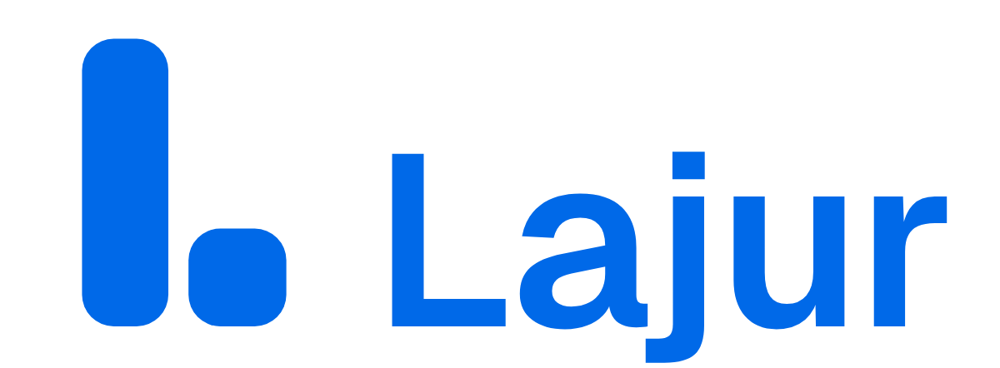

# Logo Lajur

**Ide:** huruf L yang dibangun dari dua kartu: lajur (kolom tahap seleksi) dan kartu yang baru pindah ke lajur berikutnya.
Logo ini diambil langsung dari board di aplikasi. Lamaranmu bergerak satu tahap ke depan.

## File

| Pakai untuk | File |
|---|---|
| Simbol (master, biru) | `lajur-symbol.svg` |
| Simbol ukuran kecil (≤ 20 px, favicon) | `lajur-symbol-small.svg` |
| Lockup horizontal (header, dokumen) | `lajur-horizontal.svg` |
| Lockup bertumpuk (poster, halaman kosong) | `lajur-stacked.svg` |
| Hitam / putih / satu warna | `symbol/`, `horizontal/`, `stacked/` (`*-black`, `*-white`, `*-mono-0069e8`) |
| Ikon aplikasi, favicon, ikon PWA | `symbol/` (`favicon.ico`, `favicon.svg`, `apple-touch-icon.png`, `icon-192/512.png`, `maskable-512.png`) |
| Presentasi + mockup | `presentation/board.html`, `presentation/slide-*.png` |

Di aplikasi, logo dipakai lewat `src/components/logo.tsx` (`<Logo />`, `<LogoMark />`). Favicon dan ikon ada di
`src/app/` (`favicon.ico`, `icon.svg`, `apple-icon.png`) dan `public/` (ikon PWA, dipakai `src/app/manifest.ts`).

## Konstruksi

- Grid 256 × 256. Kolom berukuran 60 × 200 dan kartu 68 × 68. Jarak antarkeduanya 14, dan semua sudut memakai radius 22. Alas keduanya sejajar.
- Potongan kecil, untuk 20 px ke bawah: kolom 64 × 192, kartu 68 × 68, jarak 28, radius 16. Jarak yang lebih lebar menjaga
  dua kartu tetap terpisah di favicon 16 px.
- Wordmark memakai Geist SemiBold (lisensi SIL OFL, boleh untuk logo), yang di file master sudah diubah menjadi path. Tinggi huruf kapitalnya
  0,6 × tinggi simbol, baseline-nya sama dengan alas simbol, dan jarak dari simbol ke teks selebar satu kolom (60).

## Warna

| | HEX | RGB | Catatan |
|---|---|---|---|
| **Biru Lajur** | `#0069E8` | 0 105 232 | = `oklch(0.55 0.21 258)`, warna `--primary` di aplikasi. Kontras 5,0 : 1 di atas putih |
| Putih | `#FFFFFF` | 255 255 255 | Logo di atas biru atau latar gelap |
| Hitam | `#000000` | 0 0 0 | Cetak satu warna, faks, stempel |

CMYK dan Pantone belum ditetapkan. Kalau mau dicetak, minta percetakan mencocokkan warnanya ke `#0069E8` dengan proof.

## Aturan pakai

- **Ruang kosong:** di sekeliling logo, sisakan minimal selebar satu kartu (sisi kartu ≈ ¼ tinggi simbol).
- **Ukuran minimum:** simbol 16 px (gunakan potongan kecil di bawah 20 px), lockup horizontal 24 px tingginya.
- **Latar:** biru di atas putih atau abu terang. Putih di atas biru Lajur atau latar gelap. Di atas foto, letakkan logo di
  area yang tenang, atau pakai versi putih di atas bidang gelap.
- **Jangan:**
  - mengubah warna di luar palet;
  - memiringkan, memutar, atau meregangkan logo;
  - menambah bayangan, outline, atau gradasi;
  - memisahkan kartu dari kolomnya;
  - mengganti font wordmark;
  - menaruh logo biru di atas latar biru.

## Catatan

- Belum ada pengecekan merek dagang. Lakukan pencarian di PDKI (pdki-indonesia.dgip.go.id) sebelum dipakai secara
  komersial.
- Hasil uji: terbaca di 16, 24, 32, dan 64 px, dalam satu warna dan versi terbalik (`svg_audit` 100/100 untuk simbol).
